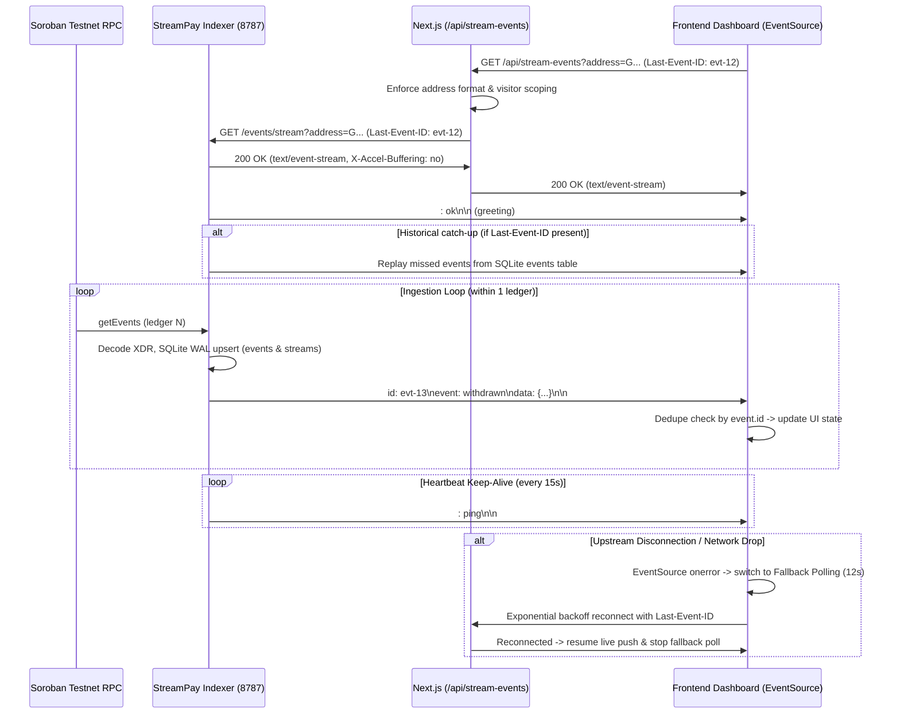

# StreamPay Real-Time Event Feed Contract & Architecture

This document defines the channel schema, wire protocol, delivery semantics, and design justifications for StreamPay's real-time dashboard powered by Server-Sent Events (SSE) streamed from the indexer service.

---

## 1. Overview & Architecture

StreamPay eliminates periodic polling loops by establishing a reactive, real-time push channel from the Soroban event indexer through a Next.js API edge proxy directly into the viewer's dashboard.



---

## 2. Channel Schema & Event Wire Format

### 2.1 Transport Headers

The indexer and proxy stream use the standard W3C Server-Sent Events (`text/event-stream`) protocol:

| Header | Value | Purpose |
|---|---|---|
| `Content-Type` | `text/event-stream; charset=utf-8` | Declares SSE event stream |
| `Cache-Control` | `no-cache, no-transform` | Prevents proxy response caching and compression transforms |
| `Connection` | `keep-alive` | Keeps persistent HTTP channel open |
| `X-Accel-Buffering` | `no` | Instructs reverse proxies (Nginx, Netlify, Cloudflare) to flush chunks immediately without buffering |

### 2.2 Event Envelope Schema

Every contract state transition emitted onto the channel has the following format:

```http
id: <unique_event_id>
event: <event_type>
data: <json_payload>
```

#### Supported Event Types (`event:` field)

1. `stream_created`: A new stream has been initialized on-chain.
2. `withdrawn`: Accrued funds were claimed by recipient or sender.
3. `stream_cancelled`: Stream was terminated early with balance settlement.
4. `stream_topped_up`: Sender deposited additional funds extending duration or rate.
5. `stream_paused`: Stream accrual was temporarily halted.
6. `stream_resumed`: Stream accrual was resumed.

#### JSON Data Payload (`data:` field)

```json
{
  "id": "0000000123456-00001",
  "streamId": "42",
  "eventType": "withdrawn",
  "ledger": 123456,
  "ledgerClosedAt": "2026-10-17T12:00:00Z",
  "data": {
    "withdrawn_total": "2500000",
    "amount": "500000"
  },
  "stream": {
    "id": "42",
    "streamId": "42",
    "sender": "CAAAAAAAAAAAAAAAAAAAAAAAAAAAAAAAAAAAAAAAAAAAAAAAAAAAITA4",
    "recipient": "CAAAAAAAAAAAAAAAAAAAAAAAAAAAAAAAAAAAAAAAAAAAAAAAAAAAHK3M",
    "token": "C_XLM",
    "deposit": "10000000",
    "withdrawn": "2500000",
    "startTime": "1700000000",
    "endTime": "1700100000",
    "cancelable": true,
    "status": "active",
    "lastLedger": 123456,
    "updatedAt": "2026-10-17T12:00:00Z"
  }
}
```

---

## 3. SSE vs. WebSocket Decision & Justification

| Dimension | Server-Sent Events (SSE) | WebSockets (WS) | StreamPay Justification |
|---|---|---|---|
| **Communication Pattern** | Unidirectional (Server -> Client) | Full-duplex (Bidirectional) | **SSE wins:** Blockchain stream updates flow strictly from chain/indexer to viewer. Client mutations (creates, withdrawals) are signed on-chain via Freighter and submitted via Soroban RPC, never through a dashboard socket. |
| **Authentication & Scoping** | Standard HTTP GET headers, cookies, query params | Upgrade handshake (`101 Switching Protocols`), custom auth subprotocol | **SSE wins:** `/api/stream-events?address=G...` seamlessly supports visitor scoping, Next.js route protection, and standard bearer/cookie auth without maintaining custom connection authentication state. |
| **Proxy Buffering & Edge Platforms (Netlify / Vercel)** | Standard chunked HTTP response (`Transfer-Encoding: chunked`) | Requires dedicated WebSocket server or external gateway | **SSE wins:** Netlify and serverless edge runtimes natively buffer or terminate persistent WebSockets, requiring third-party hosted socket services (e.g. Pusher/Ably). SSE works over standard HTTP/1.1 and HTTP/2 chunked streams with `X-Accel-Buffering: no`. |
| **Reconnection Semantics** | Built-in browser `EventSource` auto-reconnect + native `Last-Event-ID` tracking | Manual heartbeat pings, reconnect state machines, and bespoke replay buffers | **SSE wins:** Browsers automatically track `Last-Event-ID` and send it upon reconnect. The indexer replays missed events from its SQLite log without custom client application logic. |
| **Network & Firewall Friendliness** | Runs over standard HTTP/HTTPS (ports 80/443), works through corporate firewalls | Often blocked by restrictive corporate proxies or DPI filters | **SSE wins:** Indistinguishable from standard HTTPS streaming traffic. |

---

## 4. Consistency Guarantees & Deduplication

### 4.1 At-Least-Once Delivery
- The indexer writes all incoming Soroban RPC events to an append-only SQLite `events` table indexed by `id`, `stream_id`, and ledger sequence before committing.
- Upon client reconnection, the client transmits `Last-Event-ID: <id>` (or `?lastEventId=<id>`).
- The indexer queries `SELECT ... FROM events WHERE rowid > (SELECT rowid FROM events WHERE id = ?)` and flushes historical events before attaching the subscriber to the live event broadcast bus.

### 4.2 Client-Side Deduplication by Event ID
- Because network disconnects or restarts can trigger replay of already-received events, the frontend client hook (`useStreamEvents`) maintains a bounded FIFO cache (`seenEventIdsRef`, size 1,000).
- Incoming events are checked against `seenEventIdsRef.has(event.id)`.
- If an event ID has already been processed, it is dropped as a duplicate.
- **Guarantee:** At-least-once upstream transport + client-side event ID deduplication guarantees **strictly exactly-once state mutation** in the UI.

---

## 5. Graceful Degradation: Fallback Polling

When the SSE stream is disrupted (e.g. indexer service restart, local network dropout, or edge timeout):

1. **Failure Detection:** `EventSource.onerror` fires and marks connection as `"fallback_polling"`.
2. **Immediate Sync:** The hook triggers an immediate fallback poll to read on-chain stream indexes.
3. **Periodic Poll Loop:** The hook schedules a background poll every 12–15 seconds to keep the dashboard refreshed.
4. **Exponential Backoff Reconnect:** In the background, reconnection attempts follow exponential backoff with jitter:
   $$\text{delay} = \min(30000, 1000 \times 2^{\min(\text{attempt}, 6)} + \text{jitter})$$
5. **Seamless Recovery:** As soon as the indexer feed re-establishes, the fallback interval is cleared, the status badge returns to `🟢 Live (SSE)`, and live event push resumes.

---

## 6. Load & Resource Cost Note (Connection-per-Viewer)

### 6.1 Server & Edge Resource Profile
- **Memory Overhead per Connection:**
  - Idle SSE HTTP connection in Node.js/Express: ~2 KB to 5 KB per socket (simple socket handle and event listener).
  - Compare to full-duplex WebSocket: ~50 KB to 100 KB per connection (TCP buffers, frame decoders, masking key state).
- **Socket / File Descriptor Limits:**
  - Standard Linux server configuration (`ulimit -n 65535`) comfortably supports 10,000+ concurrent idle SSE streams per single core indexer instance.
- **Heartbeat Overhead:**
  - Heartbeat comment `: ping\n\n` emitted once every 15 seconds costs ~10 bytes per viewer every 15 s (< 1 byte/s per viewer).
- **Edge Buffering & Proxy Timeouts:**
  - Cloudflare / Netlify default HTTP request timeouts (typically 26s to 30s) are kept alive indefinitely by the 15s heartbeat comment frames.
- **Visitor Scoping Filter Cost:**
  - Address filtering is performed in-memory on the broadcast emitter (`event.data.recipient === address || event.data.sender === address`), consuming sub-microsecond CPU per event broadcast.
